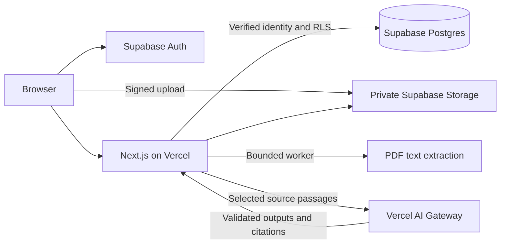

# Recallio

Recallio turns one source into a private study set. Read a cited summary, review flashcards, take a server-graded quiz, or ask questions that link back to supporting passages.

**[Open Recallio](https://recallio-saideevans-projects.vercel.app)** · **[Verification report](docs/verification.md)**


## Try it

1. Choose **Explore sample**. Open a citation in the summary to jump to the original passage.
2. Flip a flashcard and choose **Review again**. The card appears in the review queue.
3. Take a quiz, submit your answers, and retry missed questions. Unanswered questions appear separately. Accuracy uses the number answered.
4. Sign in by email to save your own sources. Choose **New study set**, paste notes or upload a text-based PDF or TXT, review the extraction, then choose **Generate tools**.

Sample practice stays in the browser. Private sets and completed attempts persist in Supabase. The sample tutor has three curated answers. The private tutor calls a configurable model through Vercel AI Gateway.

## Architecture



Private APIs require a Supabase user token. Postgres applies owner policies and checks a server-only secret for study data. The browser receives the answer key only for a submitted quiz or a question it has locked in immediate-feedback mode. Attempts snapshot the questions so later edits preserve historical scores.

TXT must contain UTF-8 text. The default limits are 30,000 pasted characters, 5 MB per upload, 100 pages and 100,000 extracted characters. PDF parsing runs in a separate worker with a memory limit and a 20-second deadline. Originals use signed upload URLs, which also accommodate files above Vercel's request-body limit.

Long sources are processed in groups before aggregation. The tutor uses full-text ranking for longer sources. Approved citations reference stored chunk IDs, and tutor quotations must match the cited text. Generation uses bounded retries, a 20-call daily account allowance, a 5-upload allowance, IP quotas and a shared daily call ceiling. These limits reset at midnight UTC.

## Run locally

Use Node 24, npm and a Supabase project or the local Supabase CLI stack.

1. Run `npm ci`. Copy `.env.example` to `.env.local`. Set the Supabase URL and publishable key.
2. Apply the SQL files in `supabase/migrations/` in timestamp order to the intended database. The Supabase CLI can also apply them with `supabase db push` after linking the project.
3. Generate a 32-byte random hexadecimal value for `RECALLIO_SERVER_KEY` and store it only in your host's secret manager or ignored local environment. Compute its SHA-256 digest locally. Store the digest in the database using the following SQL with your hexadecimal digest substituted.
4. Enable Supabase email sign-in. Set **Authentication → URL Configuration → Site URL** to your app origin. Allow your additional development URLs. Configure a custom SMTP sender to deliver magic links to users outside your Supabase project team.
5. Set `AI_GATEWAY_API_KEY` locally or use Vercel workload OIDC in production. The default model is `openai/gpt-4.1-mini`. Gateway credits and model availability belong to the hosting account. The account owner controls provider billing and alerts.
6. Run `npm run dev` and open the displayed URL.

```sql
insert into recallio_private.configuration(name,value)
values ('server_hash','<64-character SHA-256 hex digest>')
on conflict(name) do update set value=excluded.value;
```

| Environment variable | Purpose |
|---|---|
| NEXT_PUBLIC_SUPABASE_URL | Supabase project endpoint |
| NEXT_PUBLIC_SUPABASE_PUBLISHABLE_KEY | Public Auth/API key |
| RECALLIO_SERVER_KEY | Secret backend credential matching the stored digest |
| AI_GATEWAY_API_KEY | Optional server-side Gateway key for environments without Vercel OIDC |
| RECALLIO_MODEL | Gateway model ID |
| RECALLIO_AI_ENABLED | Set to `false` to pause generation and tutoring |
| RECALLIO_UPLOAD_ENABLED | Set to `false` to pause file upload reservations |

## Verification and releases

Run `npm run format:check`, `npm run lint`, `npm run typecheck`, `npm test`, `npm audit --omit=dev --audit-level=high` and `npm run build`. Install Playwright Chromium with `npx playwright install chromium`, then run `npm run e2e`. An installed browser can be selected with `CHROMIUM_PATH`. Set `TEST_URL` to test an already running server.

Run `npm run eval` for the full fixture benchmark. The [verification report](docs/verification.md#model-evaluation) documents the opt-in Gateway run and how to review its results.

The private integration runner uses an isolated local Supabase stack and its captured test inbox. Allow the local app origin in Supabase, apply the migrations and configure the server secret. Run `node tests/mock-gateway.mjs`, set `RECALLIO_TEST_GATEWAY=http://127.0.0.1:3196/model` and a fixture-only `AI_GATEWAY_API_KEY` in your local development process, then start the app on port 3191. Run `npm run test:private` with `TEST_INBOX_URL` pointing to the local Mailpit HTTP origin. Production always uses Vercel AI Gateway.

Commit and release from **main**. Select the Next.js preset on Vercel and configure production variables before building. Verify the production alias and commit SHA after deployment. To roll back, promote the previous known-good Vercel production deployment. Apply compatible forward migrations if a database correction is needed.

## Data controls

Deleting a set removes its live original and derived data. Account requests are recorded in `public.account_deletion_requests` for a project owner to fulfill. Verify the request, remove any remaining private Storage objects owned by the user, then remove the user via Supabase Auth. Foreign keys remove their study sets, jobs and request. Operational usage counters expire after 31 days of activity. The free deployment has no application-managed backup copies. Provider retention is governed by its service terms.

Model calls send relevant private excerpts to the configured provider. Logs contain status, timing and token counts. See [Supabase backup policy](https://supabase.com/docs/guides/platform/backups), [Vercel AI Gateway](https://vercel.com/docs/ai-gateway) and [OpenAI data controls](https://platform.openai.com/docs/guides/your-data).
